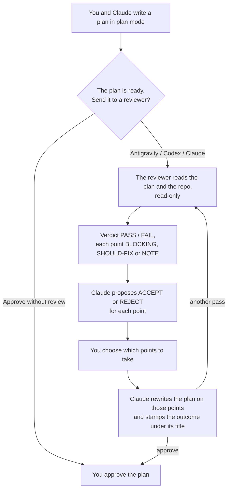

<p align="center">
  
</p>

# Adversarial Plan Reviewer

**A second model checks your plan against the real code before you approve it.**

Claude Code writes a plan with you. Before you approve it, this plugin can send it to a reviewer from another vendor — Google's Gemini through Antigravity, or OpenAI through Codex — or to a second, headless Claude. The reviewer opens your repository read-only, checks the plan's claims against the code, and comes back with a verdict and a list of points. Claude proposes what to do with each point, you choose which to take, and Claude rewrites the plan on those points only.

It is not a gate. It never blocks you, never starts a review you did not ask for, and never picks a reviewer for you.

## At a glance



- **Three reviewers, none the default.** Antigravity, Codex or headless Claude Code; you pick one each time. A model from another vendor does not share Claude's blind spots. A second Claude does, but it checks a plan against the code just as carefully.
- **Read-only.** The reviewer cannot change anything. Each one is locked down in its own way: Antigravity runs as an agent with no shell, Claude with a read-only tool allowlist, Codex inside the operating system's sandbox.
- **Evidence, not opinions.** Every point cites a `file:line` and carries a label: `[BLOCKING]`, `[SHOULD-FIX]` or `[NOTE]`. The verdict is `FAIL` if and only if at least one point is blocking.
- **A trace in the plan.** A `> **Review**:` line under the plan's title says whether the review ran, failed or was skipped, and it stays in the plan you approve.

## Install

**Requires Claude Code** on your own machine. The reviewers are command line tools that the plugin runs in your local shell, and the review loop runs in Claude Code's plan mode. In claude.ai chat it has nothing to run them with.

```
/plugin marketplace add giuseppelanzi/adversarial-plan-reviewer
/plugin install adversarial-plan-reviewer@adversarial-plan-reviewer-marketplace
```

Then set up at least one reviewer. You only need the ones you plan to use.

| Reviewer | Command line tool | One-time setup |
|---|---|---|
| Antigravity | `agy` | Log in once by running `agy` in a terminal. Install the read-only reviewer agent: the first review gives you the command. |
| Codex | `codex`, plus `timeout` or `gtimeout` | `codex login` |
| Claude | `claude`, already there | none |

All three also need `jq`. On macOS, `brew install jq coreutils` installs `jq` and `gtimeout`.

About the Antigravity agent: it lives in agy's own configuration, which a Claude Code plugin cannot write to. So the first Antigravity review stops and gives you a `cp` command, with the path already filled in. Run it once per machine. If an update changes the agent, the plugin notices and asks you to run it again.

## What changes once it is installed

The plugin is active in every repository you open with Claude Code, not only the one you install it from. Four things change:

- **A question on every non-trivial plan.** When a plan is ready, Claude asks: *The plan is ready. Send it to a reviewer before approving it?*, with `Antigravity`, `Codex`, `Claude` and `Approve without review`. Trivial plans get no question: a rename, a one-line fix, a mechanical edit to one file.
- **Plan mode, proposed.** Outside plan mode, before a non-trivial change, Claude proposes switching to plan mode. If you decline, it carries on as you asked, without a review. If you have already told it to go ahead without a plan, it does not propose it.
- **A folder in each project.** Every plan Claude proposes is saved under `.claude/plans/` in the current repository: one timestamped copy per plan, plus `latest.md`. The plugin never edits your `.gitignore`, so add `.claude/plans/` to your global gitignore once.
- **A warning on plans with no trace.** If a plan reaches the approval dialog without a `> **Review**:` line, a hook warns you in the terminal and marks the copy it saved in `.claude/plans/`. It never blocks a plan, never approves one, and never edits the plan you approve.

To turn all of this off for a while, disable the plugin from `/plugin`.

## Where your data goes

The plugin has no server and collects nothing. The reviewer is a command line tool you installed, and it runs under your own account with that vendor:

- **What is sent:** the plan or document under review, and every file the reviewer opens in your repository. It goes to Google for Antigravity, OpenAI for Codex, Anthropic for Claude, under the terms of your account with them.
- **Where the reviewer can read:** Antigravity refuses to read outside the repository. Codex does not: its sandbox blocks writes, not reads. Only the critic's instructions keep it inside the repository.
- **Repository instructions:** Codex reads the repository's `AGENTS.md` as instructions, and headless Claude reads `CLAUDE.md`.

## Usage

```
> [plan mode] design the multi-tenant schema migration
> [you and Claude discuss the plan]
> [Claude: "The plan is ready. Send it to a reviewer before approving it?"]
> Codex
> [the critique, Claude's proposal for each point, and "which points do we take?"]
> [you pick the points; Claude rewrites the plan and asks: another pass, approve, or keep discussing]
```

You can also ask at any moment and name the reviewer: *"ask Antigravity about this plan"*, *"have Codex review the plan"*. If you ask without naming one (*"review the plan"*), Claude asks which reviewer to use. Another pass goes back to the same reviewer, which checks that its own points were fixed.

It works on any document, not only plans: *"review docs/auth-analysis.md"*, *"dai un'occhiata a questa specifica"*. The critic adapts to what it is reading:

| The document | What every point must cite |
|---|---|
| a plan, or an analysis of this code | a `file:line` in the repository |
| a specification, a proposal, a note not about this code | a verbatim quote from the document |

Only a plan gets the `> **Review**:` line. When you review one of your own files, the outcome is reported in the chat and nothing is written to the file. The answer comes back in the language of your conversation or document.

## The trace in the plan

A review that nobody can see might as well not have happened. So the outcome is written into the plan itself, right under its title:

```
> **Review**: Antigravity (`gemini-4-argon-high`) — VERDICT: FAIL — 11 files read
> 7 points taken (3 BLOCKING, 3 SHOULD-FIX, 1 NOTE), 1 set aside (1 BLOCKING)
> Plan rewritten on the points taken; another pass recommended (BLOCKING taken).
```

The line takes one of four forms: the review **ran**, it **failed** (`Plan NOT verified`), it **never started** (for example, the reviewer's tool is missing), or it was **not run**, either because the plan was trivial or because you chose to skip it. If a reviewer fails, the plugin reports the error and stops. It never retries on its own, and it never switches to another reviewer without asking you.

## Customization

- **Critic prompts:** `reviewers/plan-critic.md` and `reviewers/doc-critic.md`. Every reviewer uses the same two, so you can compare reviewers on the same document.
- **Models:** Antigravity uses `gemini-4-argon-high` and Codex uses `gpt-6.1-sol` at high effort. Override them with `PLAN_REVIEW_MODEL` and `PLAN_REVIEW_CODEX_MODEL`.
- **Time limits:** each review gets 5, 15 or 30 minutes, chosen from the size of the document and of the repository. Override with `PLAN_REVIEW_TIMEOUT`, in seconds, and on the Claude side `PLAN_REVIEW_MAX_TURNS`.
- **The hook's notice:** the line at the top of a saved plan that declares no review. Override its text with `PLAN_REVIEW_NOTICE`.

Set the variables in the environment you start Claude Code from.

## Going deeper

[`docs/internals.md`](docs/internals.md) explains how it works and why:

- the review loop, and the three reviewers with their exact flags;
- the known traps, each measured on a real run;
- the design choices you might disagree with;
- how to install without the plugin system, and how to develop it locally.

## License

[MIT](LICENSE) © Giuseppe Lanzi
