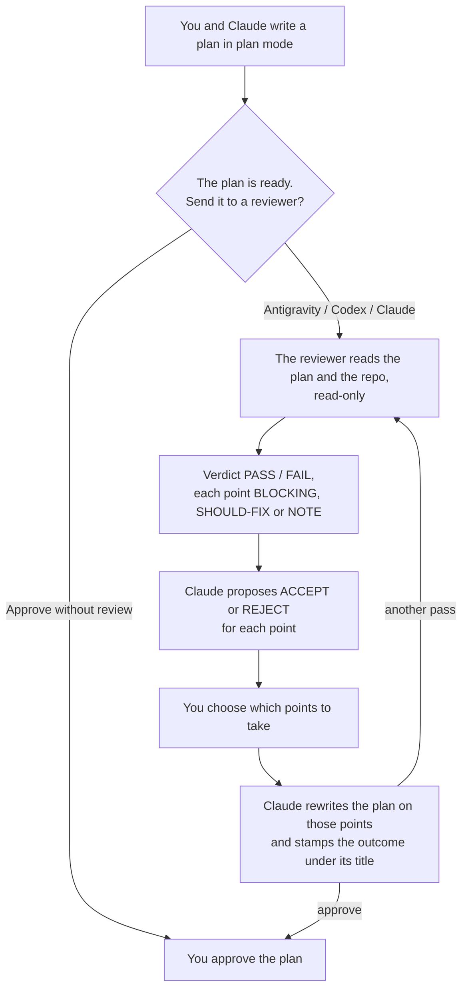

# Claude AI Reviewer plugin

Adversarial review of Claude Code plans by an external model, with a point-by-point proposal from Claude and the final word to you.

It installs as the `plan-review` plugin, with one skill per reviewer: `/plan-review:antigravity`, `/plan-review:codex`, `/plan-review:claude`.

It runs when you decide, with the reviewer you pick. Claude makes the plan with you, and when the plan is ready it asks whether to send it to a reviewer, and to which one; it always runs when you ask for it outright. It is not a gate: it never blocks you, it hands you a critique, Claude's proposal for each point, and a plan rewritten on the points you choose — approving or rejecting stays your call.

## At a glance



- **Three reviewers, none the default**: Antigravity (Google's Gemini), Codex (OpenAI) and a second, headless Claude Code. You pick one each time.
- **Read-only**: the reviewer opens the repo to check the plan against the code, and can change nothing.
- **Your call**: a trivial plan — a rename, a one-line fix — gets no question, and you can ask for a review of any plan or document at any moment. Whatever happens, a `> **Review**:` line under the plan's title says so.

---

## How it works

1. Write a plan in plan mode — or, outside it, accept Claude's proposal to enter it — and discuss it with Claude.
2. **When Claude considers the plan ready**, it asks: *The plan is ready. Send it to a reviewer before approving it?* — `Antigravity` / `Codex` / `Claude` / `Approve without review`. To keep discussing, answer in free text: the question takes four options at most. A trivial plan — a rename, a one-line fix, a mechanical edit to a single file — gets no question.
3. On a reviewer picked, its skill checks that its CLI is in place — for agy, its read-only reviewer agent too — spends ten to thirty seconds on a **read probe** on the first review of a conversation — *list the files at the root, nothing else* — and hands the plan document to that reviewer. The reviewer reads the repo read-only and comes back with a `PASS` / `FAIL` verdict, labelling every point `[BLOCKING]`, `[SHOULD-FIX]` or `[NOTE]`.
4. Claude proposes `ACCEPT` / `REJECT` for each point, with its concrete consequence, and asks **which points to take** — a multiple-choice question, or a free answer with the numbers.
5. Claude rewrites the plan on the points you took and only those, shows the diff, and asks: another pass, approve, or keep discussing. Another pass goes to the same reviewer, which checks that its own points were resolved; a different one only if you name it. A `[BLOCKING]` taken makes another pass *recommended*; you decide.

Plan mode blocks writes, not reads, so the reviewer runs from inside it — and the plan document is the one file Claude may edit there. That is what lets the *review → choose → revise → propose* loop close before the plan reaches the approval dialog. Without it the only way to get a plan reviewed is to propose it, **reject** it to get the turn back, and then ask for the review.

You can still ask for one at any other moment — *"review the plan"*, *"review docs/auth-analysis.md"*. That path is what the hook serves: it writes every proposed plan to `.claude/plans/latest.md` **in the current repo**, on the proposal and *before* you approve it. It costs milliseconds, blocks nothing, and calls no model.

### The trace it leaves in the plan

As far as the plan is concerned, a review you cannot see did not happen. So the review status travels **in the document**, right under the title:

```
> **Review**: Antigravity (`gemini-4-argon-high`) — VERDICT: FAIL — 11 files read
> 7 points taken (3 BLOCKING, 3 SHOULD-FIX, 1 NOTE), 1 set aside (1 BLOCKING)
> Plan rewritten on the points taken; another pass recommended (BLOCKING taken).
```

Four shapes, and one of them is always there: the review **ran** (verdict, files read, the points you took and set aside, what changed in the plan — and, while you are still choosing, a provisional *awaiting the user's choice*), it **failed** (which reviewer, which error, `Plan NOT verified`), it **never started** (`agy` not found, or the reviewer agent missing or outdated; `codex` not found, or no `timeout` for it; `Plan NOT verified`), or it was **not run** — for a trivial plan with the reason, or exactly *"the user chose to skip the review"*. Unlike the summary in the chat, the block survives into `.claude/plans/` and into the plan you approve.

Two things write it, and it takes both:

- **The skill**, the only one that knows what actually happened. Its rules live in `reviewers/response-protocol.md` (review ran, or failed) and in the `description` of `skills/antigravity` (review not run — that `description` is the plugin's only text that stays in context even when the skill never loads, which is exactly what happens when you decline the review).
- **The hook**, as a backstop. On `ExitPlanMode` it greps the first ten lines for `> **Review**:`; if the line is missing it prepends a notice of its own and tells you it did. It never blocks and never approves — it sets no `permissionDecision`, so the approval dialog is exactly the one you know. What it cannot do is say *why* there was no review: it only reports that nothing was declared. Its wording is overridable with `PLAN_REVIEW_NOTICE`.

The second layer exists because the first is a rule addressed to a model, and this repo has already watched one of those get skipped.

### When it runs

- **You asked** — a review, a second opinion, a named reviewer, or a plan *and* a review in one breath: it always runs, with no judgement about whether the plan deserves it. If you named no reviewer, Claude first asks *Which reviewer should review it?* — `Antigravity` / `Codex` / `Claude`.
- **You didn't ask** — it never starts on its own. When Claude considers a **non-trivial** plan ready, it asks you; any plan with architectural consequences counts as non-trivial. Trivial ones get no question: a rename, a one-line fix, a mechanical edit to a single file. Outside plan mode — auto mode, or the default one — there is no plan to ask about, so before a non-trivial change Claude first proposes plan mode, and `EnterPlanMode` asks for your consent. Accept, and the plan is made with you and the question follows; decline, and Claude proceeds as you asked, with no review and no trace.

The cost is why the question exists: a review is an external model call of up to half an hour, in the middle of planning. On an architectural plan that is often time well spent — and it is yours to spend.

The hook is deliberately on `PreToolUse`, not `PostToolUse`. Saving on approval would only give you the document once the plan is already starting — which is the wrong moment, since the whole point is to review before committing to it. On `PreToolUse` the file exists as soon as the plan is on the table, so the after-the-fact path works too: reject the plan, ask for the review, iterate. The cost is that `latest.md` also holds plans you turned down; the next proposal overwrites it, so it tracks the most recent plan rather than the last approved one.

It fires on `ExitPlanMode` and nothing else, so outside plan mode there is no backstop at all: whether plan mode gets proposed rests entirely on Claude following the rule in the `description`. `EnterPlanMode` itself works from auto mode — measured on Claude Code 2.1.311 — but whether Claude reaches for it is model behaviour, not a guarantee.

Three reviewers are available, and none is the default: you pick one each time — in the question on a ready plan, in the `Reviewer` question when you ask for a review without naming one, or by naming it yourself. A reviewer picked in a question counts as named: its skill starts without asking again.

| Skill | Command | Read-only | Output |
|---|---|---|---|
| `/plan-review:antigravity` | `agy --mode plan --sandbox --agent plan-reviewer` | plan mode + sandbox + an agent whose only tools read, with `--add-dir` as the workspace | stdout |
| `/plan-review:claude` | `claude -p --permission-mode plan` | flag + tool allowlist | `.result` |
| `/plan-review:codex` | `codex --ask-for-approval never exec --sandbox read-only` | the operating system's sandbox on everything the model runs + the account's connectors switched off with `--disable` | `--output-last-message` file |

All three are gated on the same preflight — ten to thirty seconds — and the probe runs with **the review's own flags** — that is what makes it worth the wait. It is a dress rehearsal, not a health check: a probe that ran with a friendlier command line would prove nothing about the run it precedes. When it fails, the review does not start, the plan is stamped `Plan NOT verified`, and you get the CLI's own error with its remedy.

Antigravity is a *different vendor's* model: it does not share your blind spots. The pin is `gemini-4-argon-high`, the newest Gemini tier `agy models` lists (seen on agy 1.4.0) — from another vendor, which is the point. Headless Claude verifies a plan against the code well, but it shares your model family, your `CLAUDE.md` and your conventions, which makes it the weaker adversary. Use it when you want repo-grounded verification rather than genuine disagreement.

Codex is a different vendor's model too: OpenAI's frontier models, which agy does not carry — its only OpenAI entry is the open-weights `gpt-oss-120b`. It runs when you pick it or name it, pinned to `gpt-6.1-sol` at `high` effort. It keeps its shell, inside a read-only sandbox: a different boundary from agy's, because each transport sets its own (*Known traps*). One limit to know: it loads a repository's `AGENTS.md` as instructions, the way headless Claude loads `CLAUDE.md`.

Gemini CLI used to be the default and has been removed: Google is folding Gemini Code Assist for individuals into Antigravity, and the standalone CLI now answers `IneligibleTierError` on that tier. Nothing was lost in the swap — both are Google, so the cross-vendor axis that makes the review worth running is intact. It is in the git history if you ever want it back.

If a reviewer's CLI fails — not logged in, a read refused, missing binary or agent, an interrupted connection — the skill reports the error and stops. It never retries around the problem and never falls back to a different reviewer on its own: that costs money and answers a question you did not ask. It offers the alternative in one line and waits.

---

## Repo layout

```
claude-ai-reviewer-plugin/
├── .claude-plugin/
│   ├── plugin.json          plugin manifest — manifests only in here, never content
│   └── marketplace.json     catalog, so the repo can be installed from itself
├── skills/
│   ├── antigravity/SKILL.md
│   ├── claude/SKILL.md
│   └── codex/SKILL.md
├── reviewers/
│   ├── plan-critic.md        critic prompt for a plan, or a document about this code
│   ├── doc-critic.md         critic prompt for a document that is not about this code
│   ├── response-protocol.md  how to answer the critique — shared
│   └── agy-plan-reviewer.md  the read-only agy agent the Antigravity review runs as
├── hooks/
│   ├── hooks.json            registers the hook on ExitPlanMode
│   └── save-plan.sh          saves the plan, flags one that declares no review
├── .gitignore
└── README.md
```

What is Claude Code convention and what is not:

- **Standard**: `.claude-plugin/plugin.json`, `.claude-plugin/marketplace.json`, `skills/`, `hooks/hooks.json`. These are discovered on their own.
- **Non-standard**: `reviewers/`. It is my own folder, read only because the SKILL.md files reference its path. Inside a plugin this is legitimate: the files travel with the bundle and resolve through `${CLAUDE_PLUGIN_ROOT}`. The agy agent lives here too, not in `agents/`, which Claude Code would load as agents of its own.

The most common mistake is putting `skills/` or `hooks/` **inside** `.claude-plugin/`. That directory holds **manifests, and only manifests** — the content lives beside it, at the repo root.

Two manifests is normal here, not a mistake: `marketplace.json` is *required* to sit at `.claude-plugin/marketplace.json` in a marketplace repo, and this repo is a marketplace of itself, so both files share the directory legitimately. What never joins them is a skill, a hook, or a command.

---

## Installation

### Option A — as a plugin (recommended)

Push this repo to GitHub, then in Claude Code:

```
/plugin marketplace add giuseppelanzi/claude-ai-reviewer-plugin
/plugin install plan-review@plan-review-marketplace
```

You can check the manifests at any time with:

```bash
claude plugin validate .
```

The reviewer agent is not installed by the plugin: it lives in agy's own configuration, which a Claude Code plugin does not touch. You need no clone to get it. On the first Antigravity review the preflight finds it missing, stops, and hands you the `cp` command with the real path of the plugin in Claude Code's cache already filled in. Run it once per machine — and again whenever a plugin update changes the agent: the preflight compares the two copies and says so.

### From disk, and how to reload it

The repo is a marketplace of itself — `marketplace.json` sits next to the manifest — so it installs from its own directory, with no GitHub in the loop:

```bash
claude plugin marketplace add "/local/path/to/claude-ai-reviewer-plugin"
claude plugin install plan-review@plan-review-marketplace
```

Installing does not link that directory, it **copies** it to `~/.claude/plugins/cache/<marketplace>/<plugin>/<version>/`. So editing the repo changes nothing in a running Claude Code, and reloading takes two commands — the first refreshes the catalog from the directory, the second reinstalls the plugin from it:

```bash
claude plugin marketplace update plan-review-marketplace
claude plugin update plan-review@plan-review-marketplace
```

Then restart Claude Code; `plugin update` says so itself.

**`plugin update` compares the `version` in `.claude-plugin/plugin.json`, and nothing else.** Leave it untouched and you get `already at the latest version` however much the code changed — the most convincing way to believe you have reloaded when you have not. Bump the version on each local iteration, or force the copy through:

```bash
claude plugin uninstall plan-review@plan-review-marketplace
claude plugin install plan-review@plan-review-marketplace
```

What it does *not* need is a commit: a directory marketplace copies the working tree as it stands, untracked files included. `installed_plugins.json` does record a `gitCommitSha`, but that only describes where HEAD was at install time — it is not what the update compares.

Every version keeps its own folder in the cache and nothing prunes the old ones, so `ls ~/.claude/plugins/cache/plan-review-marketplace/plan-review/` reads as a history of what you installed.

For a tight edit-and-test loop, skip installation entirely. This reads the directory live — no version bumps, no cache, no reload:

```bash
claude --plugin-dir "/local/path/to/claude-ai-reviewer-plugin"
```

### Option B — no plugin, user level

If a marketplace feels like too much machinery for personal use:

```bash
mkdir -p ~/.claude/skills ~/.claude/reviewers ~/.claude/hooks ~/.gemini/config/agents
cp -r skills/* ~/.claude/skills/
cp reviewers/*.md ~/.claude/reviewers/
cp reviewers/agy-plan-reviewer.md ~/.gemini/config/agents/plan-reviewer.md
cp hooks/save-plan.sh ~/.claude/hooks/ && chmod +x ~/.claude/hooks/save-plan.sh
```

The agent is copied twice on purpose: agy looks for agents only in `~/.gemini/config/agents/`, and the preflight compares that copy with the one next to the critics.

Outside a plugin nothing substitutes `${CLAUDE_PLUGIN_ROOT}` for you, so replace it with `$HOME/.claude` in every `SKILL.md` file. Then add the contents of `hooks/hooks.json` to `~/.claude/settings.json`, with the script's absolute path in place of `${CLAUDE_PLUGIN_ROOT}`:

```json
{
  "hooks": {
    "PreToolUse": [
      { "matcher": "ExitPlanMode",
        "hooks": [{ "type": "command",
                    "command": "bash /Users/USER/.claude/hooks/save-plan.sh",
                    "timeout": 5 }] }
    ]
  }
}
```

Spell the path out in full: `$CLAUDE_PROJECT_DIR` is reliably expanded in hook commands, `$HOME` and `~` carry no such guarantee.

### Option C — a single project

Same as option B, but in `<repo>/.claude/` instead of `~/.claude/`, with paths becoming `$CLAUDE_PROJECT_DIR/.claude/...`. The agent still goes in `~/.gemini/config/agents/`: agy has no per-project place for it. Only worth it if you want to tune the critic prompt for that specific repo.

---

## Where the plans end up

Always in the repo you are working on, never in the plugin:

```
<repo>/.claude/plans/
├── 20260829-143012.md
└── latest.md          ← the one the skill reads
```

This is the only thing the system writes into your projects. Add `.claude/plans/` to your `.gitignore`, or put it in your global gitignore once and forget it.

---

## Prerequisites

- `jq` — used by the hook and by every skill.
- At least one of `agy`, `claude` or `codex`. You simply do not use the skill for the ones you do not have.
- For `codex`: a login done once (`codex login`, in a terminal), and `timeout` or `gtimeout` — required, see the last point.
- For `agy`: credentials cached from an earlier interactive login (`agy`, once, in a terminal).
- For `agy`, **the `plan-reviewer` agent**, installed once per machine — the only setup you add by hand:

  ```bash
  mkdir -p ~/.gemini/config/agents
  cp reviewers/agy-plan-reviewer.md ~/.gemini/config/agents/plan-reviewer.md
  ```

  With a plugin install the preflight gives you this command with the cache path filled in. The agent lists four tools — `view_file`, `list_dir`, `grep_search`, `find_by_name` — and no shell, so headless agy never has a command to ask permission for. It replaces what this README used to ask: granting agy one shell command after another, which never converged (*Known traps*).
- `timeout` (GNU coreutils, `brew install coreutils` on macOS, where it lands as `gtimeout`). **Required for Codex**: Codex has no ceiling of its own, so the skill stops before the probe if neither name exists. Optional for the others: the Claude skill detects either name and runs with no wall-clock ceiling if neither is there, leaving `--max-turns` as the only bound; the agy skill uses `--print-timeout` instead. Either way the ceiling comes from a tier — 5, 15 or 30 minutes — chosen per document.

---

## Usage

```
> [plan mode] design the multi-tenant schema migration
> [you and Claude discuss the plan]
> [Claude: "The plan is ready. Send it to a reviewer before approving it?"]
> Codex
> [the critique, Claude's proposal per point, and "which points do we take?"]
> [you pick the points; Claude rewrites the plan on them and asks: another pass, approve, or keep discussing]
```

Or, naming the reviewer: *"ask Antigravity about this plan"*, *"have Claude review the plan"*, *"ask Codex to review the plan"*. With no reviewer named — *"review the plan"* — Claude asks which one first. After leaving plan mode, the review reads `.claude/plans/latest.md`.

It works on a document just as well as on a plan — *"review docs/auth-analysis.md"*, *"dai un'occhiata a questa specifica"* — and the critic follows the document:

| The document | Critic | Evidence it must bring | Stamped? |
|---|---|---|---|
| a plan, in plan mode or `latest.md` | `plan-critic.md` | `file:line` on every point | yes, in the plan |
| an analysis / ADR / post-mortem **about this code** | `plan-critic.md` | `file:line` on every point | no — it's your file |
| a specification, a proposal, a note **not about this code** | `doc-critic.md` | a verbatim quote of the document | no |

The second row is the one worth reading twice: the stamp depends on **whose document it is**, not on which critic ran. Only a plan gets the `> **Review**:` block; on your own files the review is reported in the chat and nothing is written.

Naming the critic overrides the choice. Whichever ran, the closing summary says which — a doc review and a code-grounded one answer different questions, and only one of them was checked against the repo.

**Timing**: the review runs *inside* plan mode, on the plan document, before the plan is proposed. Plan mode blocks writes, not reads, so bash works there — and the plan document is the one file Claude may edit, so it can revise it in place. Asking after you have left plan mode also works; it reads `.claude/plans/latest.md` instead.

---

## Customization

- **Critic prompts**: `reviewers/plan-critic.md` and `reviewers/doc-critic.md`. These are the files you will tweak most often. **One critic per kind of document, shared by every reviewer** — never one per reviewer: the comparability that matters is between reviewers on the same document, and splitting along that axis is what would destroy it. The two critics differ on what counts as evidence, not on rigour: plan-critic demands a `file:line` per point, doc-critic a verbatim quote of the document. Both keep verification inside the repository: a path outside it goes under *What I could not verify*.
- **Response protocol**: `reviewers/response-protocol.md`. Home of the two phases — Claude's binary `ACCEPT` / `REJECT` proposal per point, then your choice — of the question's shape, and of the stamp's forms.
- **Severity levels and the pass bar**: both critic prompts, which keep them identical on purpose. `FAIL` fires if and only if at least one point is `[BLOCKING]`, and blocking requires naming what concretely goes wrong. Loosen that definition and everything starts failing; tighten it and nothing does. What `[BLOCKING]` *means* is the one thing that differs: implementing the plan produces work to redo, versus acting on the document produces a wrong decision.
- **Which critic runs on what**: the selection rule in section 2 of each `SKILL.md`. A plan is never classified — it always gets `plan-critic.md`.
- **Which reviewer**: there is no default, the user picks one each time. Two questions do it, both in the `description` of `skills/antigravity` and again in its section 0: `Review` on a ready plan — *The plan is ready. Send it to a reviewer before approving it?*, `Antigravity` / `Codex` / `Claude` / `Approve without review` — and `Reviewer` on a request that names none — *Which reviewer should review it?*, the same three without the fourth. The `description` leaves out the second one's wording to stay under the cut (*Known traps*). To restore a default, replace the `Reviewer` question in that `description` with the name of the skill to run.
- **Reviewer model**: pinned in `skills/antigravity/SKILL.md` to `gemini-4-argon-high`, the newest Gemini tier `agy models` lists (seen on agy 1.4.0). Override per run with `PLAN_REVIEW_MODEL=<model>` — `gemini-3.8-flash-high`, the previous pin, is the fallback — or change the pin. This is the single biggest lever on review quality. On the Codex side the pin is `gpt-6.1-sol` with `model_reasoning_effort="high"`, in `skills/codex/SKILL.md`; override the model with `PLAN_REVIEW_CODEX_MODEL` — its own variable, since `PLAN_REVIEW_MODEL` carries a Gemini name.
- **The agy flag set**: `--mode plan --sandbox --agent plan-reviewer --add-dir --output-format stream-json`, in `skills/antigravity/SKILL.md`. `--mode plan` is agy's read-only execution mode, `--sandbox` adds terminal restrictions, `--agent plan-reviewer` is the reviewer whose tools only read, `--add-dir` is the workspace and is not optional. There is no `--effort`: the level is in the model's name, and agy 1.3.4 rejects the flag next to one. `--output-format stream-json` is what turns every failure from prose into an event you can query — and `--dangerously-skip-permissions` is deliberately **not** in the set; the traps below say why.
- **The codex flag set**: `--ask-for-approval never exec --sandbox read-only -c web_search="disabled" --ignore-user-config --ignore-rules --disable apps --disable plugins --disable goals --disable image_generation --disable hooks --json --output-last-message`, in `skills/codex/SKILL.md`. The sandbox stops writes from the shell, from `apply_patch` and from subagents; the `--disable` set removes the account's connectors, which no local sandbox reaches; `web_search` off keeps the reviewer on the repository, like the other two. `--dangerously-bypass-approvals-and-sandbox` is deliberately **not** in the set, and neither is `--ephemeral`.
- **The reviewer agent**: `reviewers/agy-plan-reviewer.md` — four read tools, and a body that states facts about the reviewer's environment and nothing about how to work. Change it here, then copy it again into `~/.gemini/config/agents/plan-reviewer.md`; the preflight refuses a stale copy.
- **The ceiling on a run**: three tiers, picked per document by the skill and stated when it is not the floor.

  | Tier | agy | claude | codex |
  |---|---|---|---|
  | short | `--print-timeout 300s` | `timeout 300` / `--max-turns 20` | `timeout 300` |
  | standard | `--print-timeout 900s` | `timeout 900` / `--max-turns 40` | `timeout 900` |
  | deep | `--print-timeout 1800s` | `timeout 1800` / `--max-turns 60` | `timeout 1800` |

  The selection rule lives in section 3 of each skill: a judgement from the size of the document, how many files and modules the plan names, and the size of the repo, with the higher tier taken in doubt. The floor is deliberately *not* the default — the review runs only on non-trivial plans, since trivial ones skip the question, so its runs start above it. Per-run overrides: `PLAN_REVIEW_TIMEOUT` (seconds, bare integer, every skill) and `PLAN_REVIEW_MAX_TURNS` (the Claude side only, where the two numbers are one unit).
- **When it asks**: the trivial/non-trivial line lives in the `description` of `skills/antigravity`, and it decides two things — outside plan mode, whether Claude proposes entering it before a change; with a plan ready, whether Claude asks you or writes the *not run* line straight away. Widen or narrow it there, and both move.
- **The hook's notice**: the text it prepends when a plan declares no review. Fixed English string in `hooks/save-plan.sh`, overridable per environment with `PLAN_REVIEW_NOTICE`. The skill's own trace follows the language of the plan; the hook cannot know it.
- **Language**: the instructions are in English, the output follows the language of the conversation or of the document. The rule is written in three places — both critic prompts and the response protocol. It applies to the critics' section headings too: on an Italian document `## Sources read` comes back as `## Fonti lette`, which is why the response protocol matches that section by role rather than by its exact English name.

---

## Known traps

- **Headless `agy` has no workspace, and that is what used to break the review.** `cd` is invisible to it: asked to list its workspace without `--add-dir`, it answers `NO WORKSPACE`. With no file tree even reading is refused — the denial names **`read_file`**, because there is nothing to read — and the run ends with **zero bytes while exiting 0**. Judge the run by its output, never by its exit code: 0 is also what success returns.

  Check the workspace claim yourself, from inside any repo — it takes one call and no permissions:

  ```bash
  agy --mode plan -p "List the files at the top level of your current workspace.
  Use ONLY your file-listing tool. If you have no workspace, say: NO WORKSPACE." </dev/null
  ```

- **With agy's default agent, looking around means the shell — and the shell never converges.** agy reads a named file with no permission, but to *enumerate* it reaches for `run_command` — since agy 1.2.7 its default agent has no tool that lists a directory — and headless cannot show you an approval dialog, so the call is refused and the run usually ends. Granting one command prefix at a time does not settle it: asked only to list the root, the probe was refused four times, on four different commands — `python3 -c "…os.listdir('.')…"`, `git status && git branch`, `ps aux`, `claude plugin validate .`. This README used to prescribe six shell commands to pre-grant; that list never held.

- **The fix is an agent with no shell, not a permission.** An agy custom agent lists the tools it may use; `plan-reviewer` lists `view_file`, `list_dir`, `grep_search` and `find_by_name`. That list does two things: it **adds** the three listing and search tools, which agy 1.2.7 retired from the default agent and kept only for custom agents that name them in `tools`, and it **leaves out** the shell, the write tools and subagents. Asked to name its tools, the default agent lists `run_command`, `write_to_file`, `invoke_subagent` and others but no listing tool; `plan-reviewer` lists its four and `manage_task`. Asked outright to run `ls -A`, it answers `NO SHELL TOOL`, and a full review ran in 257 seconds over 13 files with no refusal at all. It is the agy twin of `--allowedTools "Read,Grep,Glob"` on the Claude side.

- **Do not give the agent `excludeDefaultComponents: true`.** It looks like the clean way to strip the default tools, and it also strips the prompt section that tells the agent where its workspace is: the agent guessed `/workspace`, and the read was refused. The `tools` list alone already removes `run_command`.

- **A plan that names paths outside the repo draws the reviewer there.** `~/.claude/plans/…`, `~/.gemini/config/…` — the reviewer tries to open them, and the read is refused (the action is `read_file`, whatever tool asked). Sometimes the run ends empty, sometimes it records the refusal and delivers a full critique: both measured on the same plan. `plan-critic.md` now keeps *open it* inside the repository and sends outside paths to *What I could not verify*. When you do want an outside file read, re-run with one more `--add-dir` for its directory — a **new** run, since the workspace is fixed when a run starts. A narrow `read_file(<path>)` allow rule is agy's documented alternative, unmeasured here. Never open `~/.gemini` whole: agy refuses reads of its own settings anyway, and it holds your credentials.

- **The installed agent can fall behind the plugin.** agy reads its copy in `~/.gemini/config/agents/`, not the one in this repo. The preflight compares the two byte for byte and refuses a stale one, which is why an update that changes the agent asks you to copy it again.

- **agy updates itself, and 1.3.4 broke the old pin twice.** `gemini-3.1-pro-high` left `agy models` (the Pro tier needs a costly plan), and a model name that carries its level now rejects `--effort`: `invalid model selection (--model "gemini-3.1-pro-high" --effort "high"): --effort is not supported`. The pin moved to `gemini-3.8-flash-high` with no `--effort`, then to `gemini-4-argon-high` once the Gemini 4 Argon tier appeared in `agy models` — still no `--effort`, the level is in the name. With it the probe takes about half a minute instead of fifteen seconds (26 measured). An unknown model makes the whole skill fail rather than degrade: `agy models`, then `PLAN_REVIEW_MODEL=<one of them>`. That list also carries Claude models and the open-weights `gpt-oss-120b`, but none of OpenAI's frontier models — for those there is `/plan-review:codex`.

- **Three remedies that look obvious and do nothing.** Each was measured against the shell refusals, before the agent existed. **Trusting the workspace**: agy keeps a `trustedWorkspaces` list, and the same folder, trusted, fails identically. **Naming the tool**: telling agy to use `list_dir` did not stop it reaching for `run_command` — it could not, since the default agent has no `list_dir`; naming it in the agent's `tools` did. **Dropping `--mode plan`**: the refusal is identical with the flag and without it.

- **If you reach for `--dangerously-skip-permissions`, your own host blocks it.** It approves every tool for one run. In auto mode Claude Code's classifier refuses to launch a command carrying it — `Reason: [Create Unsafe Agents]` — and nothing ever reaches agy. With the agent it would add nothing anyway: there is no shell left to approve.

  Two things this repo will not do about it. It will not let Claude write an allow rule for itself — that is separately refused, `[Auto-Mode Bypass]`, and an agent that grants itself permissions is precisely what the check exists for. And it will not hide the flag in a wrapper script to keep the classifier from reading the string: that works, and it defeats the intent of a check you installed.

- **Do not tell the reviewer which tools to use.** An earlier draft of the skill put *«the shell is not available to you, use the file-reading tools»* in the prompt. agy reached for `run_command` anyway. Telling the reviewer a fact about its environment is fair (*this run has no channel to answer you*, *a read outside the workspace is refused*); narrowing the environment itself — the agent's tool list — is fair too; telling it how to work is the same mistake as preparing its context, one layer down.

- **The event stream is what makes a failure legible.** `--output-format stream-json` costs nothing and replaces a pile of heuristics on stderr: a refusal is a `step_update` in `state: "ERROR"` carrying the tool and its target — `AbsolutePath`, `DirectoryPath`, `SearchPath` or `SearchDirectory`, depending on the tool — a run killed by the ceiling is the absence of a `result` event, an artefact or a subagent shows up as its own step, and the critique itself is `.result.response`. `init.conversation_id` is the other half: with it, `--conversation "<id>"` resumes an interrupted review instead of paying for it twice. Measured: a review cut by a network error resumed, kept what it had read, and finished.

- **`status` is not the verdict.** A refused run reports `status: SUCCESS` with an empty response; a resumed run has reported `status: ERROR` with a whole critique in it. A response with a `VERDICT:` line is a review, anything else is not.

- **The probe is a dress rehearsal, not a health check.** Before the first review of a conversation, each skill asks its reviewer to list the root of the workspace and compares the answer with `ls -A`. It runs with the review's own flags — the agent included — for the same reason a rehearsal uses the real set: softened, it would predict nothing. Fifteen to thirty seconds settle what would otherwise surface at the end of a quarter-hour run: credentials, the model pin, the workspace, and the agent reaching the root. It passes when the names are the ones of *this* directory, including at least one a model could not have guessed. When it fails, the review does not start and the plan is stamped `Plan NOT verified`.

- **The question of which points to take has a shape to respect.** `AskUserQuestion` takes 2 to 4 options per question and at most 4 questions, and defaults to single choice. The protocol writes `multiSelect: true` out, turns a lone point into *take / set aside*, balances the blocks (5 points → 3 + 2, never 4 + 1), and falls back to a free answer past 16 points.

- **A long critique comes back as a pointer, not as the review.** Left alone, agy treats an extensive report as an artefact: it writes the review to a file under its own working directory and returns one line on stdout naming the path. That output is *not empty*, so it sails past every "did the run fail" check. The prompt carries an **Output Delivery Constraint** to prevent it, forbidding `write_to_file` and demanding the critique verbatim in the response. Under `plan-reviewer` the write itself is gone — the agent has no `write_to_file` — and the constraint stays for the response it shapes: the critique verbatim, not a sentence about where it is. If you ever see a plan review summarised as "the review is in review.md", that constraint went missing.

- **The critic and its framing line are one unit, and the framing line is easy to forget.** Every `SKILL.md` bash block carries a `FRAMING` string right above the document, and under `plan-critic.md` it orders the reviewer to *"verify every claim it makes by reading this repository yourself"*. Swap `CRITIC` to `doc-critic.md` and leave that line behind, and you have told a reviewer to find code behind a text that has none — it obeys by inventing `file:line` references, and the result is a review that looks grounded and is not. The two variables sit next to each other for this reason. The reverse mistake, doc framing with `plan-critic.md`, is quieter: the review simply stops verifying.

- **`--log-file` is the only real diagnostic.** A muted run gives you one line of stderr and nothing else. `agy … --log-file /tmp/agy.log`, then `grep -iE 'permission|grant|project' /tmp/agy.log`, tells you whether the workspace was lost or a tool stopped the run.
- **The five-minute ceiling was never agy's.** `--print-timeout` defaults to `0s`: agy waits for the turn to complete, with no limit at all. The cap is this plugin's own choice — which is why it is a tier of three, 5 / 15 / 30 minutes, picked per document instead of one number for everything. What makes a generous ceiling cheap is that a timeout is a ceiling and not a budget: a review that needs four minutes takes four minutes whatever the ceiling, so the tier only decides how long you wait before concluding the run is broken.
- **On the Claude side, raising the timeout alone buys nothing.** `--max-turns` bounds the agent loop independently of the clock, so a longer wrapper with 20 turns still ends at turn 20 — and comes back with a *partial* critique that looks complete. The two numbers are the tier and they move together, which is why there are two override variables rather than one. A timeout is silent there as well, because the wrapper kills the process instead of reporting: exit `124` or `143`, a truncated envelope, and the `!! output is not JSON, raw:` fallback printing it.
- **`timeout` does not exist on macOS.** GNU `timeout` is not shipped with macOS; `brew install coreutils` provides it as `gtimeout`. The Claude skill picks whichever exists and runs unwrapped if neither does, so a stock Mac degrades instead of dying on `command not found`. The Antigravity skill uses agy's native `--print-timeout` and needs no wrapper. The Codex skill takes either name too, but stops when both are missing: Codex has no turn cap, so unwrapped would mean unbounded. (The Mac this was last measured on, Darwin 27.2, does ship `/usr/bin/timeout`; older ones may not.) On the Claude side, unwrapped means `--max-turns` is the only ceiling left: at the short tier that was a footnote, at the deep tier the half-hour ceiling simply does not exist on that machine.
- **On Codex the shell stays, and that is not the agy mistake.** agy's reviewer lost its shell because agy's default agent could not explore headless without one and the grants never converged. Codex keeps it because `--sandbox read-only` runs what the model executes under the operating system's sandbox. Measured on `codex-cli 0.166.0`: `codex sandbox -P :read-only` fails `touch` with `Operation not permitted` inside and outside the working directory; in a model run `apply_patch` was refused (`patch rejected: writing is blocked by read-only sandbox`), and so was a subagent's write — subagents inherit the sandbox. Launched from Claude Code in auto mode, the command started cleanly: no classifier refusal, no clash with a sandbox around the Bash tool. Each transport sets its own boundary; do not carry one into another.

- **The account's connectors survive `--ignore-user-config`.** With the configuration ignored, a Codex run still listed about a hundred `mcp__codex_apps__*` tools — the ChatGPT account's apps: deploying sites, editing their environment variables, parental controls, repository write credentials. They act on external services, where a local sandbox has no say, and they come from the `apps` feature, on by default, not from `config.toml`. `--disable apps` removes them all; `--disable plugins`, `goals` and `image_generation` take care of `request_plugin_install`, `create_goal` and `image_gen`. `--disable multi_agent` does **not** remove `collaboration.*` — harmless, since the subagents inherit the sandbox, but do not count on the flag.

- **Codex's read-only is not repository-only.** Asked to read a file in another temporary directory, the reviewer did. `--cd` sets the working directory, not a boundary. The only fence is `plan-critic.md`'s rule that sends outside paths to *What I could not verify* — the opposite of agy, where such reads are refused.

- **Codex's event stream is not a full log.** It does not name the model — the stamp names the one passed with `--model`. In the measured runs, a shell write and the `apply_patch` calls left no item in it. A refused call reaches stderr instead, as `codex_core::tools::router: error=…`. The critique is the `--output-last-message` file, written only when a turn completes, so every run — probe and review — gets a fresh `mktemp -d` directory: with a fixed path, a run that dies would hand you the previous critique, and two sessions reviewing at once could swap theirs. And the exit code comes first: `124` is the ceiling, a failed run even if a critique is on disk.

- **A project's own MCP servers were not loaded.** A repository `.codex/config.toml` declaring a harmless MCP server that logs its own start never started it — under the skill's flags, and even with the project marked trusted through a `-c projects."<path>".trust_level` override, with the isolation flags and without. Some other trust path is not ruled out.

- **Codex loads a repository `AGENTS.md`.** A fixture `AGENTS.md` asking for a marker line got it, with `--ignore-user-config` and `--ignore-rules` on the command line, from the reviewer and from its subagent. It is this reviewer's `CLAUDE.md` problem. Whether `--ignore-user-config` skips `~/.codex/AGENTS.md` is not measured.

- **`--ask-for-approval` is a global `codex` option.** It goes before `exec`; `codex exec --help` does not list it. With `never`, a refused call comes back to the model as an error instead of waiting for an approval headless cannot give.

- **`codex exec resume` takes no `--sandbox`.** Nor `--cd`. A resumed review would run under a sandbox nobody chose, which is why the Codex skill offers a new run after an interruption, not a resume. The session is saved anyway — no `--ephemeral` — so resuming can come once its sandbox is measured.

- **Codex refuses a directory that is not a git repository.** Exit 1, no events: `Not inside a trusted directory and --skip-git-repo-check was not specified.` Adding the flag is the user's call, never the skill's.

- **`$CLAUDE_PROJECT_DIR` is a hook variable, not a shell one.** It is set for hook commands, but it is empty in the shell the skill runs its bash in. `cd "$CLAUDE_PROJECT_DIR"` then silently stays put, and `$CLAUDE_PROJECT_DIR/.claude/plans/latest.md` resolves to `/.claude/plans/latest.md`. The skills use `${CLAUDE_PROJECT_DIR:-$PWD}`.
- **`agy -p` swallows the next argument as its prompt.** Every other flag goes *before* `-p`. `agy -p --mode plan "..."` takes `--mode` as the prompt and drops the real one.
- **`.result` on the Claude side**, and `.is_error` is set on a failed run that still exits 0. Reading the wrong field yields empty output and no error.
- **`--max-turns` is undocumented.** It works on `claude -p` but does not appear in `claude --help`. If a future version rejects it, drop the flag rather than the review.
- **`${PIPESTATUS[0]}` is bash-only.** Claude Code's Bash tool runs zsh, where that expands to nothing and the exit code silently vanishes (zsh spells it `$pipestatus[1]`, 1-indexed). The skills redirect the reviewer's output to a file and read plain `$?` instead of piping into `jq`.
- **`claude -p` waits on stdin.** Without `</dev/null` it blocks 3 seconds and warns `no stdin data received in 3s`. Every skill redirects stdin, and `codex exec` needs it as much: it reads stdin even when the prompt is an argument (`Reading additional input from stdin...`). The prompt is an argument, never piped.
- **`${CLAUDE_PLUGIN_ROOT}` is substituted into the SKILL.md text, not read from the environment.** Claude Code expands it when it loads the skill, so by the time the instructions arrive the path is already absolute and the literal string never reaches a shell. It is reliable in skills for that reason — it is how the preflight hands you the agent's `cp` command with the real cache path. The *environment variable* of the same name is a different thing and is empty in the shell the Bash tool runs, so a script that generates a command at runtime cannot use it. Note the substitution applies to the braced form `${CLAUDE_PLUGIN_ROOT}`; `$CLAUDE_PLUGIN_ROOT` written bare is left alone.
- **Plugin edits reach a running session only under `--plugin-dir`.** There, changes to `SKILL.md` take effect immediately while changes under `hooks/` do not — those need `/reload-plugins` or a restart, and the trace backstop lives under `hooks/`, so it stays dormant until you reload. Installed from a marketplace none of that applies: you are running the copy under `~/.claude/plugins/cache/`, and nothing you edit in the repo is live until you update *and* restart. See *From disk, and how to reload it* above — in particular that the update is keyed on the version string, so an unbumped `plugin.json` reloads nothing while reporting success.
- **Skills fire everywhere.** At user level or as a plugin they apply in every repo, including ones where `agy` is not installed. If it gets noisy, narrow the `description`s.
- **A skill's `description` is cut at about 1,500 characters, silently.** The listing that puts it in context truncates it with an ellipsis. Measured: a 1,804-character description reached the model cut after 1,523 characters, mid-word (`non-t…`) — inside the very sentence that had just been appended; the 1,496-character one of 0.8.0 arrived whole. Past the cut nothing is in context, and the `description` is the only copy that counts when the skill never loads: a rule appended at the end is a rule nobody reads. It now stands at 1,429. Keep it under ~1,450, and check a change in a `--plugin-dir` session by asking Claude to quote the description's last sentences verbatim.
- **The hook rewrites the plan it is given.** When the plan carries no `> **Review**:` line in its first ten lines, `save-plan.sh` returns it through `hookSpecificOutput.updatedInput` with a notice prepended, and archives that version. So a plan in `.claude/plans/` can open with a line Claude never wrote. It sets no `permissionDecision` — the approval dialog is untouched — and it builds `updatedInput` from the original `tool_input` object with `.plan` replaced, so any other field survives. If a future version stops honouring `updatedInput` on `ExitPlanMode`, the `systemMessage` and the archived copy still carry the notice: the degradation is partial.
- **`.tool_input.plan` is undocumented.** `hooks/save-plan.sh` reads the plan text from it, but the field no longer appears in the `ExitPlanMode` schema (which now exposes only a deprecated `allowedPrompts`). It still arrives — measured again on Claude Code 2.1.296. Nothing critical depends on it any more: the skills pass the document inline and can find it without the hook, so if the field ever disappears you lose the saved history and the hook's notice, not the review or the trace the skill writes itself.
- **`cp`, not `ln -s`, for `latest.md`.** Tempting to symlink; don't. Creating a symlink on Windows/NTFS needs elevated privileges or Developer Mode, and the hook would die with `Operation not permitted`. The copy costs a duplicate file and works everywhere.
- **The hook does not touch your `.gitignore`.** It creates `.claude/plans/` in the target repo and stops there. Writing into another project's git configuration from inside a hook is a surprise nobody asked for, so ignoring that directory stays your call.

---

## Debatable choices

Two things are rigid on purpose, but you may not like them in practice:

- **Binary proposal on each point.** "Partially valid" is the escape hatch through which a critique gets absorbed without changing anything. On some critiques, though, the honest answer really is somewhere in between. If you see forced answers, soften the protocol.
- **You are the judge, Claude is the advocate.** It used to be the other way round: Claude — the author of the plan — ruled `ACCEPTED` / `REJECTED` on criticism of its own work, and the protocol could only make motivated reasoning harder. Now Claude *proposes*, with the `file:line` or the constraint behind each proposal, and you choose which points to take. The price is a second turn and a question per review; the gain is that a point you think matters cannot be argued away by the plan's own author.
- **Adversarial is a persona, not a structure.** The critic has no stake: it does not win by finding a flaw or lose by missing one. What actually does the work is the fresh context reading the real code without the conversation's accumulated assumptions — which is why *"do not prepare context for it"* is the load-bearing instruction in every skill. Start passing it a helpful summary and the tone stays adversarial while the value disappears.

  One thing that is *not* a violation of that rule: the plan document itself travels inline, inside the prompt. It has to — the plan lives outside the repo while you are in plan mode, the reviewer's permissions are anchored to the workspace, and plan mode won't let Claude copy it in. But the document is the **object under review**, not context about the code, and by value or by reference is a transport detail. The line to hold is the other one: no summaries, no extracted snippets, no curated file list. The reviewer opens the repo itself, or the review is worth nothing.

And one limit that does not go away: the critic judges internal consistency and apparent completeness. It does not tell you whether the plan is looking in the right place — only you know that. The review reduces the verification work, it does not replace it.
